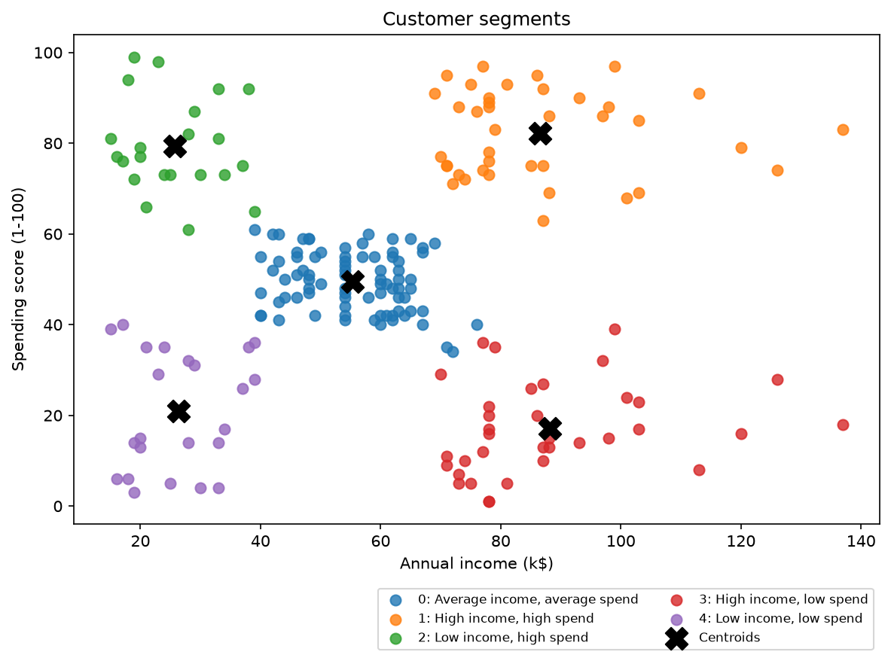

# Data Cleaning, Validation and Customer Segmentation

A small, reusable Python project that turns messy tabular data into an analysis-ready dataset,
then uses the cleaned data to segment customers with K-means clustering.

It has two parts:

1. **A schema-driven cleaning and validation pipeline** that handles duplicates, missing values and
   inconsistent formats, and records every change it makes.
2. **A customer segmentation workflow** applied to the public Mall Customers dataset.

## Design principles

- **Nothing disappears silently.** Rows that fail validation go to `quarantine.csv` with a reason. They are never dropped.
- **Every change is counted.** `audit_log.csv` lists each transformation and how many rows it touched.
- **Required fields are never guessed.** A missing ID or date quarantines the row.
- **Imputation is visible.** Only optional numeric columns are filled (median), and a `<column>_was_missing` flag is added.
- **The input file is never modified.**
- **The pipeline checks itself.** Assertions fail loudly if duplicate keys or nulls in required columns survive.

## Project structure

```
.
├── src/
│   ├── clean_pipeline.py        # core cleaning + validation pipeline (edit SCHEMA here)
│   ├── clean_mall.py            # schema for the Mall Customers dataset
│   ├── segment_customers.py     # K-means segmentation, plots, segment profiles
│   └── generate_sample_data.py  # builds the messy demo dataset
├── data/
│   ├── sample/messy_customers.csv   # deliberately dirty demo data (committed)
│   └── raw/                         # put Mall_Customers.csv here (not committed)
├── outputs/
│   ├── demo_cleaning/           # before/after results on the messy demo data (committed)
│   └── segmentation/            # segment plots and profiles
├── tests/test_pipeline.py
├── requirements.txt
└── LICENSE
```

## Quick start

```bash
git clone https://github.com/<your-username>/<repo-name>.git
cd <repo-name>
python -m venv .venv
.venv\Scripts\activate          # Windows   (macOS/Linux: source .venv/bin/activate)
pip install -r requirements.txt
```

### 1. Cleaning demo (works out of the box)

```bash
python src/clean_pipeline.py data/sample/messy_customers.csv --out outputs/demo_cleaning
```

### 2. Customer segmentation on Mall Customers

Download `Mall_Customers.csv` into `data/raw/` (see `data/raw/README.md`), then:

```bash
python src/clean_mall.py                  # clean the raw file
python src/segment_customers.py           # cluster and plot
python src/segment_customers.py --k 4     # optional: force 4 segments
```

### 3. Tests

```bash
pip install -r requirements-dev.txt
pytest
```

## Cleaning results on the messy demo data

`data/sample/messy_customers.csv` has 425 rows with injected problems: exact duplicates, duplicate IDs
with partial records, placeholder nulls (`N/A`, `-`, `null`), invalid emails, four different date
formats, impossible ages, inconsistent country names and currency strings.

| Metric | Count |
|---|---|
| Raw rows | 425 |
| Exact duplicates removed | 15 |
| Duplicate IDs resolved (most complete record kept) | 10 |
| Rows quarantined | 39 |
| **Clean rows** | **361** |

Quarantine reasons (a row can have more than one):

| Reason | Rows |
|---|---|
| Missing name | 16 |
| Missing signup date | 11 |
| Out-of-range spend | 5 |
| Future signup date | 5 |
| Out-of-range age | 4 |

Other fixes recorded in `outputs/demo_cleaning/audit_log.csv`: 19 invalid emails blanked, placeholder nulls
normalized in every column, country variants (`USA`, `U.S.`, `United States`, `Bharat`, `england`, ...)
mapped to `US` / `IN` / `GB`, and 18 missing ages and 29 missing spend values imputed with the median
and flagged.

**Before** (`data/sample/messy_customers.csv`):

| Customer ID | Name | Email | Signup Date | Age | Country | Spend |
|---|---|---|---|---|---|---|
| C0270 | Jack   Wilson | jack.wilson270@example.com | 06/07/2021 | 64 | england | $4,321.85 |
| C0017 | Isha   Rao | isha.rao17@example.com | 11/24/2022 | 28 | Bharat | $1,498.44 |
| C0190 | RAHUL MEHTA | rahul.mehta190@example.com | 19 May 2025 | 62 | India | $1,017.35 |

**After** (`outputs/demo_cleaning/cleaned.csv`):

| customer_id | name | email | signup_date | age | country | spend |
|---|---|---|---|---|---|---|
| C0270 | Jack Wilson | jack.wilson270@example.com | 2021-06-07 | 64 | GB | 4321.85 |
| C0017 | Isha Rao | isha.rao17@example.com | 2022-11-24 | 28 | IN | 1498.44 |
| C0190 | Rahul Mehta | rahul.mehta190@example.com | 2025-05-19 | 62 | IN | 1017.35 |

## Segmentation results (Mall Customers, 200 customers)

Customers are clustered on annual income and spending score (standardized). The silhouette score selects
5 segments.

| Segment | Customers | Avg age | Avg income (k$) | Avg spend score | Profile |
|---|---|---|---|---|---|
| 0 | 81 | 42.7 | 55.3 | 49.5 | Average income, average spend |
| 1 | 39 | 32.7 | 86.5 | 82.1 | High income, high spend |
| 2 | 22 | 25.3 | 25.7 | 79.4 | Low income, high spend |
| 3 | 35 | 41.1 | 88.2 | 17.1 | High income, low spend |
| 4 | 23 | 45.2 | 26.3 | 20.9 | Low income, low spend |



**Takeaways.** Segment 0 is the largest group (40% of customers). Segment 3 earns as much as the best
segment but spends little, so it is the clearest opportunity. Segment 2 is the youngest and spends heavily
on lower incomes. Age was not used for clustering, so the age differences emerged on their own.

Suggested actions per segment are inferences from the profiles, not tested strategies.

## Adapting the pipeline to your own data

Edit the `SCHEMA` dictionary in `src/clean_pipeline.py` (or override it, as `src/clean_mall.py` does):

```python
SCHEMA = {
    "order_id":   {"type": "str",      "required": True, "key": True},
    "amount":     {"type": "float",    "required": True, "rng": (0, 100000)},
    "order_date": {"type": "date",     "required": True},
    "status":     {"type": "category", "required": False,
                   "map": {"done": "COMPLETED", "canceled": "CANCELED"}},
}
```

| Option | Meaning |
|---|---|
| `type` | `str`, `int`, `float`, `date`, `email` or `category` |
| `required` | If true, a missing value sends the row to quarantine |
| `rng` | Allowed `(min, max)`; values outside it quarantine the row |
| `key` | Marks the unique identifier used for deduplication |
| `map` | Lookup that standardizes category variants |

Column names are matched after lowercasing and replacing spaces and symbols with underscores
(`Annual Income (k$)` becomes `annual_income_k`).

## Limitations

- Ambiguous dates such as `03/04/2023` are read month-first. Change `dayfirst=False` in `coerce_types` for day-first data.
- Median imputation is simple and ignores relationships between columns.
- Segmentation uses only two features and assumes roughly round clusters. Spending score is a relative index, not money spent.
- The two smallest segments have about 20 customers each, so their averages are approximate.

## License

MIT, see [LICENSE](LICENSE).
